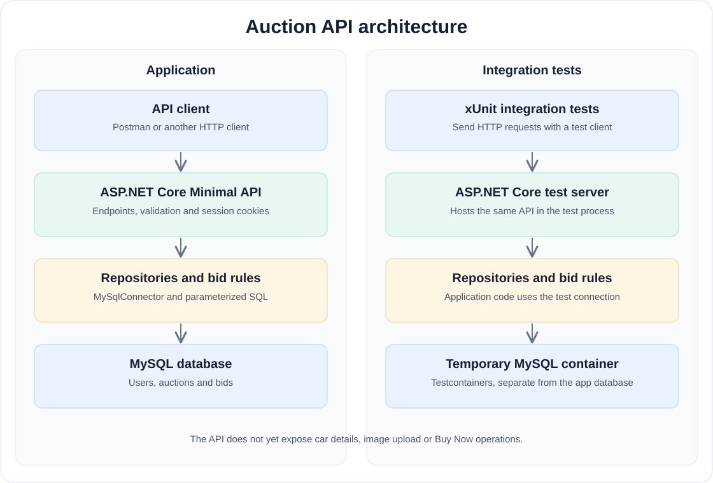

# Auction API design



The current implementation uses **MySqlConnector and SQL repositories**, not Entity Framework's `DbContext`. Postman is one possible API client; it is not part of the application. The API does not currently have PUT or auction-delete endpoints.

## Architecture

```text
Client (for example Postman)
    -> REST endpoints
    -> Repositories and bid rules
    -> MySQL
```

| Component | Responsibility |
| --- | --- |
| Client | Sends HTTP requests and reads JSON responses. |
| [Program.cs](../Program.cs) | Configures the application, session, dependencies and endpoints. |
| [Endpoints](../Endpoints) | Handle HTTP requests, basic validation, sessions and responses. |
| [Repositories](../Repositories) | Read and write data using parameterized SQL and MySqlConnector. |
| [Rules](../Rules) | Contain bid validation that can be tested independently of MySQL. |
| [Models](../Models) and [DTOs](../DTOs) | Represent stored data and API request/response data. |
| MySQL | Stores users, auctions and bids in related tables. |

## Example: placing a bid

1. The buyer logs in and receives a session cookie.
2. The client sends `POST /api/auctions/{id}/bids` with the cookie and an amount.
3. The endpoint checks the session and gets the buyer ID.
4. The repository checks that the auction exists, calls `BidRules.Validate` and saves a valid bid in MySQL.
5. The API returns a response, such as `201 Created`, `400 Bad Request`, `401 Unauthorized` or `404 Not Found`.

The current bid rule checks that the amount has at most two decimal places. Additional rules and protection against simultaneous conflicting bids still need implementation.

## Database

The basic [database script](../Database/script.sql) defines:

- **users**: account details and password hash.
- **auctions**: name, end time and seller; each auction belongs to a user.
- **bids**: amount, time, buyer and auction; each bid belongs to a user and an auction.

The alternative [car-auction schema](../Database/car-auctions.sql) adds car details, starting and Buy Now prices, images and purchases. The API does not yet expose these additional fields or implement image and Buy Now operations.

## Testing

The [test project](../SimpleAuctions.Tests) uses xUnit and an ASP.NET Core test server to call the API. Testcontainers starts a separate MySQL container using the car-auction schema. Data is cleared between tests, and the container is removed after the run. The optional sample data is not loaded automatically.

See [Test.md](../Test.md) for running the tests and [DatabaseTest.md](../DatabaseTest.md) for sample database setup.